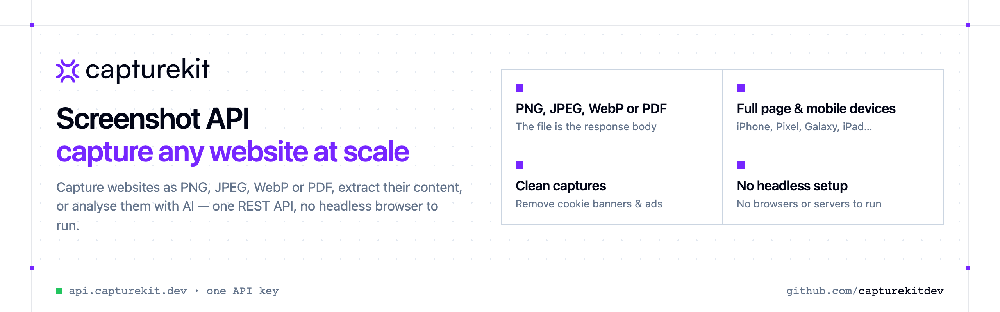

<p align="center">
  <a href="https://www.capturekit.dev"></a>
</p>

<p align="center">

[](https://discord.gg/CFj3ph8aHU) [](https://www.capturekit.dev) [](https://app.capturekit.dev/register) [](https://app.capturekit.dev/openapi)

</p>

**CaptureKit** is a **Screenshot API**: send a URL, get back an image (PNG, JPEG, WebP) or a PDF of the page — full page, mobile devices, without cookie banners or ads. The same API also extracts page content and analyses websites with AI.

### Why CaptureKit?

- **Screenshots as a service** — the response body *is* the image or PDF; save it or upload it straight to your S3 bucket.
- **Pixel-perfect options** — full page, viewport size, scale factor, element `selector`, 18 mobile/tablet devices, delays and wait conditions.
- **Clean pages** — remove cookie banners, ads and any CSS selector before capturing.
- **Beyond screenshots** — extract content (metadata, links, HTML, Markdown) or get an AI analysis of any page.
- **Copy-paste examples** — Python and TypeScript in each README, 7 more languages in `examples/`.

```bash
curl -G https://api.capturekit.dev/v1/capture \
  -H "x-api-key: $CAPTUREKIT_API_KEY" \
  --data-urlencode "url=https://github.com/seaweedfs/seaweedfs" \
  -o screenshot.png
```

### Repositories

- [**AI Website Analyzer API**](https://github.com/capturekitdev/ai-website-analyzer-api) — AI summary, value proposition & features of any website
- [**Full Page Screenshot API**](https://github.com/capturekitdev/full-page-screenshot-api) — Capture entire web pages, top to bottom, as one image
- [**Mobile Screenshot API**](https://github.com/capturekitdev/mobile-screenshot-api) — Screenshot websites as seen on iPhone, Pixel, Galaxy or iPad
- [**Screenshot API**](https://github.com/capturekitdev/screenshot-api) — Capture any website as PNG, JPEG or WebP with one API call
- [**Website Content API**](https://github.com/capturekitdev/website-content-api) — Extract metadata, links, HTML & Markdown from any page
- [**Website Crawler API**](https://github.com/capturekitdev/website-crawler-api) — Fetch raw HTML of any page, fast
- [**Website to PDF API**](https://github.com/capturekitdev/website-to-pdf-api) — Convert any URL into a PDF document with one API call

---

💬 [Discord](https://discord.gg/CFj3ph8aHU) · 📚 [API reference](https://app.capturekit.dev/openapi) · 🔑 [Get your API key](https://app.capturekit.dev/register) · 🌐 [www.capturekit.dev](https://www.capturekit.dev)
